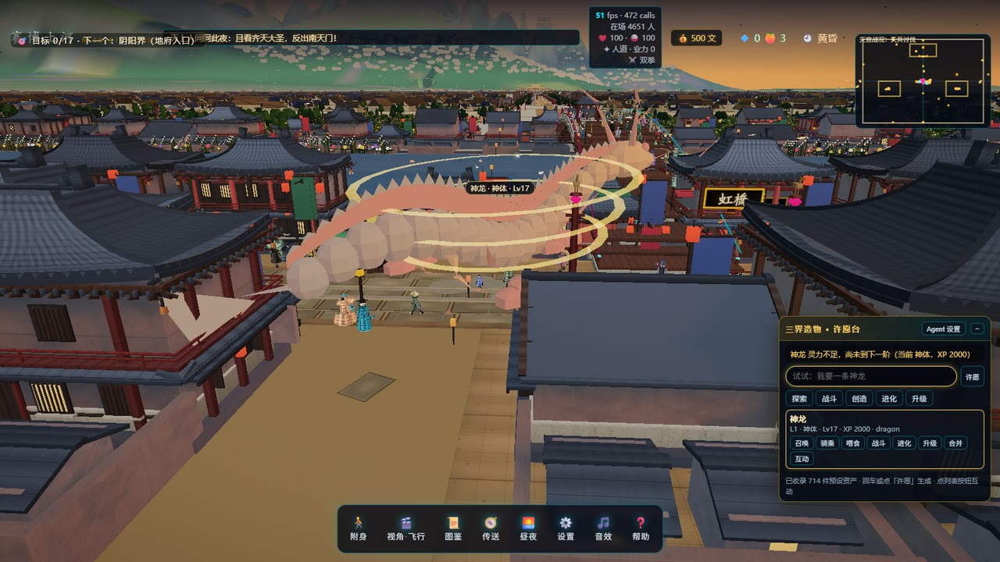
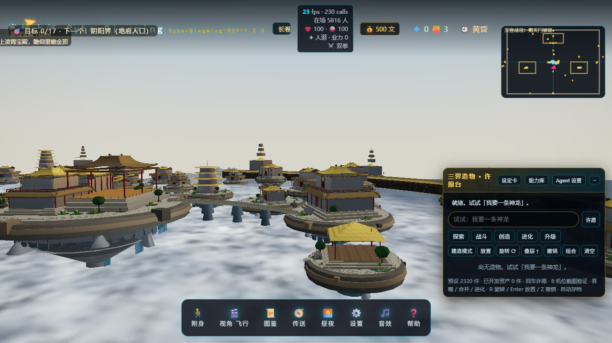

# 赛博上河 · CyberQingming-R29-1.2.0

> 用 Three.js 实时渲染的「全 3D 清明上河图」：整座北宋汴京城程序化生成，千人市井行为模拟，水浒 108 将全城在位，天空层《大闹天宫》十幕战斗循环上演。赛博国潮美术（暮色霓虹 + 昼夜循环）。**零外部资产、零后端、可完全离线运行。**

 

> **R29 机检基线（数字由 `artifacts/` 台账渲染，禁止手改）**：单元测试 `318<!-- {{json:test-run.json#numPassedTests}} -->` / `318<!-- {{json:test-run.json#numTotalTests}} -->` 全绿；破坏命中 `26,999<!-- {{json:r27-collision-runtime.json#destructionHit.vertsDeformed|,}} -->` 顶点变形、`89<!-- {{json:r27-collision-runtime.json#solidsAfterHit.broken}} -->` 面墙摘除。改台账后须跑 `npm run docs:gen`，`npm run docs:check` 会把漂移拦下。

## 演示视频

[](docs/demo.mp4)

> 点击封面播放（`docs/demo.mp4`，约 34 MB，3 分 54 秒）。片头书法起势 → 汴京全城航拍 →
> 沿汴河与街市掠过 → 转山体林木，全程实时渲染、无剪辑合成。GitHub 的 README 不支持内联
> `<video>`，所以用「封面图 → 视频」的链接形式，点开即可在 GitHub 播放器里看。


## 快速开始

```bash
npm install
npm run dev        # 开发：http://localhost:5173
npm run build      # 生产构建 → dist/
npm run preview    # 生产预览：http://localhost:4173
npm test           # 单元测试（vitest）
```

### Windows 桌面端

```bash
npm run electron   # 以 Electron 壳运行（读取 dist/，需先 npm run build）
npm run dist:win   # 打包 portable .exe（输出 release-v2/）
```

### 操作

| 输入 | 功能 |
| --- | --- |
| `V` | **附身/灵魂切换**——化身青衫游侠，GTA 式第三人称漫游全城 |
| `单击画面` | **鼠标视角**：单击画面即锁定指针，之后移动鼠标直接转视角（左右改 yaw、上下改 pitch，钳位 ±85°）；`Esc` 解除锁定 |
| `左键拖拽` | **任意模式**（运镜 / 飞行 / 漫游 / 聚焦 / 附身）下按住左键拖动转视角：左右改 yaw、上下改 pitch。运镜与聚焦模式一拖即接管为飞行视角 |
| `右键拖拽` | 与左键拖拽同一条视角通道，但**不请求指针锁定**（浏览器拒绝锁定、或想保留光标时的兜底） |
| `L` | 指针锁定开关（与「单击画面」等价；锁定后不用按住任何键，移动鼠标即可连续转视角） |
| `W A S D` / 滚轮 | 移动（方向**跟随鼠标转出的视角**：鼠标转到哪，W 就往哪走）/ 推拉视距（附身模式为第三人称距离） |
| `E` | **万能交互**：买东西吃、喝茶、喝酒、看戏、听说书、听曲、抚琴、下棋、睡觉、净房、扛包赚钱、上坐骑、开船……（走近自动出现提示） |
| `Shift` / `Space` | 疾行·跳跃 / 骑龙飞行时升空（`Ctrl` 下降） |
| 任意键 | 跳过开场运镜 |
| 底部栏 | 附身 / 视角 / 图鉴 / 传送 / 昼夜 / 设置 / 音效 / 帮助 |

**视角与移动**：鼠标视角有两条通道，任选其一——① **单击画面**（或按 `L`）锁定指针，之后只移动鼠标即可连续转视角，`Esc` 解锁；② 按住**左键或右键拖拽**，不锁指针也能转。两条通道在运镜 / 飞行 / 漫游 / 聚焦 / 附身五种模式下都连续生效，运镜与聚焦一拖即接管为飞行视角。附身模式的 `W A S D` 方向由相机 `camYaw` 推出——鼠标转到哪，前进方向就跟着转到哪（实测：拖 120px → yaw −22.0°（飞行/漫游）/ −28.9°（附身），前进航向与 `camYaw+180°` 偏差 0.00°）。俯仰统一钳在 ±85°（`PITCH_LIMIT`），不会翻过头顶。

**飞行高度（本轮修复）**：飞行相机的高度范围已整体放大一倍——下限 `-640<!-- {{json:spec/fly-ceiling.json#limits.floor}} -->`m、上限 `8000<!-- {{json:spec/fly-ceiling.json#limits.ceiling}} -->`m。旧的硬编码上限 `4000<!-- {{json:spec/FIX-FLY-CEILING.json#rootCause.legacyCeiling}} -->` 比天宫基准面 `4066<!-- {{json:spec/fly-ceiling.json#limits.heavenBase}} -->`m 还低 66m，摇杆推到底也永远差一截：**「飞不到天宫」不是天宫太高，是天花板修矮了**。现在按住 `Space` / `E` 可一路升到天宫宫殿群与云海之上，`Ctrl` / `C` 下降。真机门（`scripts/probe-fly-ceiling.mjs`）断言「从旧上限继续升能穿过天宫基准面」「推到底被新上限夹住」「下限夹住」「0 条 page error」四项，证据见 `artifacts/spec/fly-ceiling.json`。



**河上桥群**：汴河主河段 `|x| ≤ 1680m` 每 420–600m 一座桥，共 7 座 6 形制——虹橋（贯木拱，x=0）、永寧橋（三孔石拱，−1680）、疊梁橋（叠梁拱，−1200）、清風橋（廊桥，−600）、通津橋（浮桥，+600）、拱辰橋（单孔石拱，+1200）、通濟橋（木梁+茶亭，+1620）。桥面拱顶高出水面 3.6–8.1m（浮桥 3.6–5.2，拱桥 6.0–8.1），航道带净空 2.58–5.48m，两端踏步落在纤道；桥位与桥面高程的唯一真源是 `src/city/layout.ts` 的 `MAIN_BRIDGES`。

**铜钱经济**：初始 500 文，码头扛包 +20 文/趟，赌坊押大小翻倍，五子棋赢 +100 文；吃喝玩乐皆需花钱（localStorage 持久化）。
**三界贯通**：阳间汴京 → 东城门「阴阳界」踏入地府（黄泉/奈何桥/阎罗殿/孟婆/黑白无常/彼岸花）→ 骑龙/仙鹤直上天宫（南天门/凌霄殿/蟠桃园/浮岛瀑布）。
**物理碰撞分级**：力量 vs 韧性实时判定，四档反馈——**趔趄 → 击倒 → 击飞 → 碎裂**。凡人拳脚只能打人趔趄；神佛法体坚韧，凡人奈何不得，巨灵神一斧能把人打飞；疾驰车辆按质量×速度撞人（停车仅趔趄，疾驰撞倒/撞飞）；凌振大炮为狙击级动能——凡人被轰得昏死、亡魂魂飞魄散、神佛也只能被轰倒；`F` 键或点击出拳，铁匠铺 30 文买钢刀威力翻倍。

移动端：左下虚拟摇杆移动，右侧拖拽转视角，双指缩放。

## 看点导航

- **虹桥**（传送→虹桥）：木质贯拱桥全复刻，大船降桅过桥戏剧循环上演；「豹子头·林冲」桥上演枪。
- **孙羊正店**：三层彩楼欢门霓虹招展；武松在十千脚店连饮十八碗（柜台上有碗为证）。
- **菜园**（虹桥西）：鲁智深倒拔垂杨柳，树随发力摇摆。
- **瓦子勾栏**：相扑（燕青）、说书场、胡旋舞、傀儡戏。
- **汴河码头**：张顺「浪里白条」泅渡、漕船摇橹、纤夫拉纤。
- **河滩**（城门西）：凌振的轰天雷焰火定期升空。
- **天上**（传送→南天门/凌霄宝殿）：十幕大闹天宫（南天门被破→天兵讨伐→哪吒→巨灵神→二郎神→宝塔镇压→雷部→直捣凌霄→佛掌降世→幕间蟠桃宴），评书战报滚动播报。

## 架构速览

- **全程序化生成**：建筑（参数化宋式：台基/柱/格窗/歇山霓虹檐边/彩楼欢门）、人物（参数化部件人形 + 45 动作原语）、招牌（canvas 汉字图集）、音效（WebAudio 合成）。mulberry32 确定性种子。
- **性能**：约 30 个 InstancedMesh 池承载全部动态物体；draw call 峰值等运行时指标以 `artifacts/` 台账为准（禁止手抄）；人群 LOD（近逐帧/中 3 帧/远 9 帧）；三档画质自动降档；世界分帧生成。
- **系统**：行为状态机（25 职业 × 35+ 行为 × 热点驻留）、战斗导演（十幕时间轴 + VFX 池：粒子/闪电/冲击环/金掌/宝塔/焰火）、昼夜循环驱动全部颜色与灯强。

详细设计：`docs/项目描述.md`；竞品分析与路线图：`docs/竞品对标与增强计划.md`；交付证据：`.acs/evidence/`。

## 硬件要求与启动实测

| 档位 | 系统内存 | 图形 |
| --- | --- | --- |
| 最低 | 8GB RAM | WebGL2，独显或 Apple Silicon |
| 推荐 | 16GB RAM | 独显 |

软渲染（SwiftShader）可运行但帧率显著下降，不推荐作为主玩环境。**诚实披露：当前版本尚未达到启动内存目标**——堆峰值目标 1536<!-- {{json:memory-budget.json#limits.heapPeakMB}} --> MB，首次真机实测 6718.1<!-- {{json:memory-budget.json#overallMeasured.heapPeakMB}} --> MB；强制 GC 后常驻目标 600<!-- {{json:memory-budget.json#limits.settledMB}} --> MB，实测 5793.7<!-- {{json:memory-budget.json#overallMeasured.settledMB}} --> MB，验收门 `FAIL(heap-peak-over-budget)`。完整两档阈值表、实测矩阵与阶段归因见 `docs/HW-REQUIREMENTS.md`、`artifacts/spec/PERF-001.json`；solids 扩容决策（当前为 `DEFERRED`）见 `artifacts/spec/PERF-003.json`。

启动自检（`QA-008`）已接线：进入世界之前采集内存、逻辑核、WebGL2 与渲染器型号，硬件不足时弹一次性提示卡并自动进低配模式；低配会收窄人群、抽稀装饰几何、关闭阴影/泛光并降低像素比，全部降级项在设置面板逐条列明，绝不静默降级。`?low=1`、`?lowmem`、`?perf=low` 可手动进低配，`?perf=normal` 可强制标准档。运行期档案见 `artifacts/boot-hw.json`，阈值与代码常量由 `scripts/qa/check-hw-thresholds.mjs` 同源机检。

`Baker.stageStats()` 现已给出逐任务、逐界域的精确几何台账（`artifacts/spec/PERF-001-stage-attribution.json`）。该数据推翻了「两界懒烘焙是主收益路径」的旧判断：天宫与地府合计只占几何量的一成不到，人间才是绝对大户。低配档的 A/B 对比、治理缺口与候选路径都写在 `artifacts/spec/PERF-001.json` 的 `comparison` / `feasibilityGap` 里；**低配是已披露的画面降级，不是性能达标证明**。

**启动期时间切片（PERF-001 R2）：已落地，未达标，如实记账。** 烘焙已从全量同步改为任务队列 + 每帧 `8<!-- {{json:spec/PERF-001-r2-slices.json#budgetMs}} -->`ms 预算切片（含地形逐 64 顶点切片与真实进度上报），五次真机 A/B 把最长进度停滞从 21.45s 压到 `20.82<!-- {{json:spec/PERF-001-r2-slices.json#maxStallSeconds}} -->`s——**离 4s 目标仍差一个量级，门判 FAIL**。运行期逐函数计时给出了决定性反证：收尾全部 JS 函数合计仅 `295<!-- {{json:spec/PERF-001-r2-slices.json#closingTimingsMs.compactStatic}} -->`ms，而页面内采样器连续约 19s 完全跑不动——停滞不在任何 JS 函数里，而在首帧 WebGL 几何上传（软渲染下 5.36 GiB 属性缓冲）。**JS 时间切片只能削 JS 同步峰，切不到 GPU / 驱动侧同步上传**，继续堆切片无效。结论与后续路径见 `artifacts/spec/PERF-001-r2-slices.json` 与 `artifacts/spec/PERF-001.json` 的 `r2Findings.decisiveNegativeFinding`。

## 诚实边界

「所有角色专属动作」采用**行为引擎 + 主角深编排**口径：108 将与 35+ 神佛每人专属动作/锚点/服色/兵刃；路人由职业行为引擎驱动（随位置/昼夜变化），非逐人独立骨骼动画。详见交付报告。
